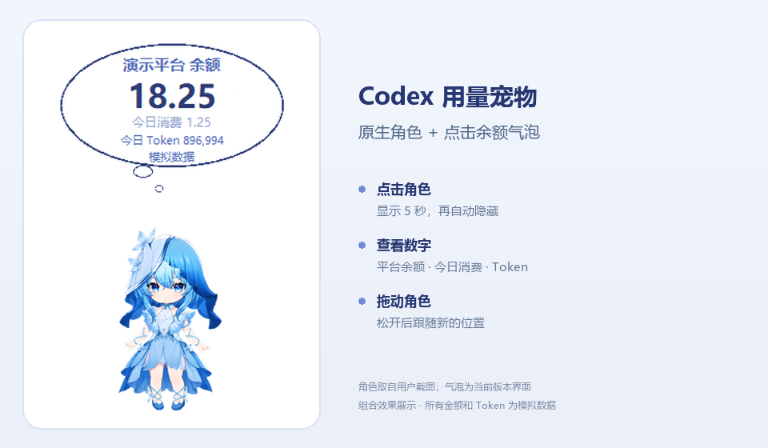
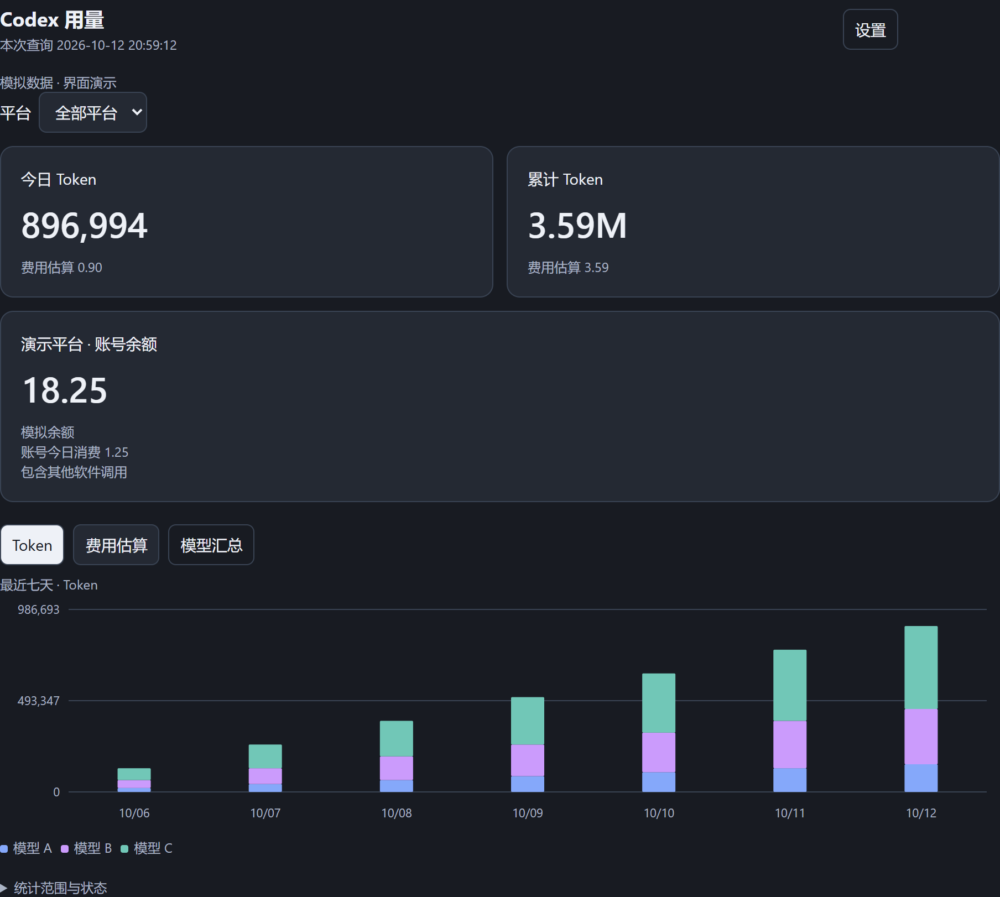
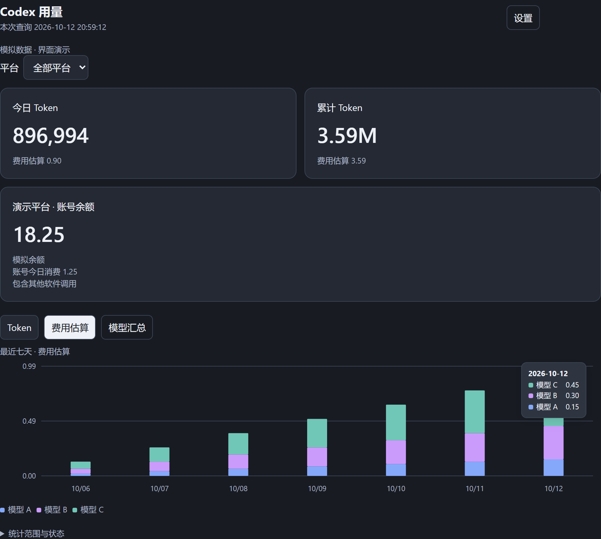
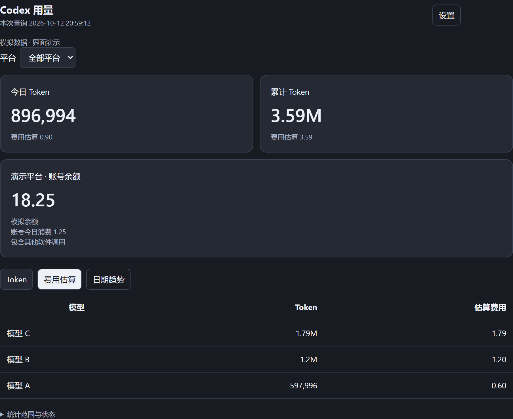

# Codex 用量宠物 · 2.0

一个面向 **Windows 11 + Codex 桌面端**的用量统计插件：给你已有的 Codex 原生宠物配上余额气泡，并在 Codex 对话中查看 Token、模型用量和费用图表。

**当前版本：2.0.0-beta.3。** 用户通过 Codex 开启和关闭，无需自己打开 EXE。宠物由 Codex 管理；气泡是插件自动启动的独立透明窗口。本项目不包含可安装的宠物动画包，也不是 OpenAI 官方插件。

## 效果预览

### 宠物旁的余额气泡



角色取自用户已创建的“守岸人”截图，配合当前版本的气泡界面作组合展示，**图中所有金额和 Token 均为模拟数据**。点击角色后显示 5 秒，再自动隐藏；拖动结束后跟随新位置。角色可以换成你自己的 Codex 原生宠物，截图中的角色不随插件安装。

<details>
<summary>展开查看统计面板：Token 趋势、费用明细和模型汇总</summary>

### 今日／累计 Token 与最近七天趋势



在 Codex 内查看本机桌面端用量；不同模型使用不同颜色。账号余额和账号今日消费单独展示，Token 达到百万使用 M。

### 费用堆叠图与紧凑悬浮明细



切换到“费用估算”，悬停柱子可查看当天各模型的金额。模型图表是按本地 Token 和配置价格计算的 Codex 估算，不是平台全账号账单。

### 按模型汇总



切换“模型汇总”查看各模型的 Token 和估算费用，此视图不弹出柱状图悬浮框。

以上面板图片使用项目内置的**模拟数据**，并在本地浏览器主题容器中渲染；嵌入 Codex 后字体、边距和颜色可能随客户端主题略有变化。图片没有包含真实账号、令牌或账单。

</details>

## 能做什么

- 点击宠物，弹出白色、蓝色轮廓的小气泡，5 秒后自动隐藏；再次点击重新计时。
- 气泡展示所选中转站余额、今日费用、今日 Codex Token 和余额更新时间。
- 拖动宠物结束后，气泡跟随新位置；也可手动摆放或常驻显示。
- 在 Codex 内查看今日／累计 Token、按模型统计、最近七天的模型堆叠柱状图，切换 Token／费用。
- 金额保留两位小数，Token 达到 1,000,000 时显示 M，零用量模型隐藏。
- 支持多个中转站；内置企鹅 API 余额及账号今日消费查询，其他平台可按真实接口文档配置或适配。
- 访问令牌在本地窗口输入，用 Windows DPAPI 加密保存。

### 统计口径：先分清这几个数字

| 指标 | 数据来源与范围 |
| --- | --- |
| 今日 Token | 本机可读取的 **Codex 桌面端**今日用量，默认北京时间；不受气泡所选平台影响 |
| 累计 Token／模型用量 | 本机保留且能确认来源的 Codex 桌面端历史；不含其他设备和已删除记录 |
| 余额 | 所选平台的**账号余额**，可能受其他软件消费、充值影响 |
| 今日估算（默认模式） | 按所选平台的 provider 映射和模型价格计算的 Codex 费用；缺少价格时显示未知 |
| 今日消费（可选模式） | 平台账号当天实际消费，**包含其他软件的调用**；当前只实现企鹅 API |
| 气泡底部“更新” | 余额上次成功查询时间，按配置时区展示 |

设置 `bubble.cost_source` 为 `"platform"` 可显示账号今日消费，无需模型价格。它不会把模型图表变成平台账单：**模型费用图表始终是 Codex 本地用量的估算**。不同币种不会合并；查询失败不将旧数字标为最新。

## 安装前准备

1. Windows 11，支持插件及原生宠物的 Codex 桌面应用。此项目面向使用 API Key 的用户。
2. Python **3.9 或更高版本**，包含 `tkinter` 和 `pythonw`。可以使用 Codex 环境已有的 Python；没有时安装 Windows Python，并启用 Tcl/Tk。运行组件只需要 Python 标准库。
3. Codex CLI 支持 `codex plugin` 命令。让 Codex 检查即可，不需要你手动寻找安装目录。
4. 想看余额时，需要平台支持的只读账号接口和相应访问令牌。**模型 API Key 与账号访问令牌不一定通用。不要把完整密钥发到聊天里。**

原生宠物不随本仓库分发。先在 Codex 的宠物设置中选择已有角色，或自行创建喜欢的宠物。

## 第一步：安装插件

### 推荐：下载后交给 Codex 安装

下载本仓库 ZIP 并解压，例如 `D:\Projects\codex-usage-pet`。检查该目录直接包含 `README.md`、`.agents`、`plugins`；`.agents` 是必须保留的隐藏目录。

把以下内容发给 Codex，将路径替换为你自己的：

> 请安装 `D:\Projects\codex-usage-pet` 中的 Codex 用量宠物插件。先阅读 README 和插件 SKILL.md，检查 Codex 插件命令、Python 3.9+、tkinter 和 pythonw 是否可用，然后注册本地插件市场并安装 codex-usage-pet。若已有旧版，先关闭气泡，将配置和加密凭证备份到插件缓存之外，再更新和恢复。不要修改我的原生宠物，也不要让我手动打开 EXE。完成后告诉我如何启用技能。

首次安装对应的命令：

```powershell
codex plugin marketplace add "D:\Projects\codex-usage-pet"
codex plugin add codex-usage-pet@codex-usage-pet-marketplace
```

`marketplace add` 后使用输出中的市场名称检查结果。上面名称与本仓库的市场清单一致。若当前客户端没有插件命令，需要先使用支持插件的 Codex 版本。

### 也可以直接从 GitHub 安装

仓库维护者将本项目文件放在仓库根目录后，用户可执行：

```powershell
codex plugin marketplace add https://github.com/你的用户名/你的仓库名
codex plugin add codex-usage-pet@codex-usage-pet-marketplace
```

将网址替换为**实际仓库地址**；不要原样执行占位地址。安装后如果技能未出现，刷新插件列表，必要时重启 Codex 并开启新对话。

## 第二步：开启宠物和气泡

1. 在 Codex 的宠物设置中打开原生宠物，选择你的角色。
2. 在 Codex 对话中发送：

   > 使用 $codex-usage 开启宠物余额气泡。

3. 点击角色并松开鼠标。气泡显示 5 秒后隐藏，等待下一次点击。**刚开启时看不到气泡是正常的。**拖动和长按不触发弹出。
4. 没配平台时仍能看 Codex Token；余额和费用显示未配置，继续下一步。

点击模式会先预取一次数据，以后点击先展示最近结果，达到刷新间隔再后台更新；余额／消费请求至少间隔 60 秒。等待点击时不定时发请求，也不会创建定时 Codex 对话。

右键气泡可以切换平台、查看单位和状态、手动摆放、恢复跟随及关闭。拖动气泡会切到手动模式。点击事件仍传给原生宠物，Codex 自己的菜单或通知也可能同时出现。

## 第三步：配置中转站

### 使用企鹅 API

把下面这段发给 Codex：

> 使用 $codex-usage 帮我配置企鹅 API（https://penguinapi.org）。余额使用内置 penguin 适配器；气泡的今日费用使用平台账号今日实际消费，即 bubble.cost_source 设为 platform，不配置猜测的模型价格。今日 Token 仍只统计 Codex。请初始化并编辑已安装插件正在使用的本地配置，通过 set-secret 打开本地令牌输入窗口，让我在窗口中填写账号访问令牌，不要在对话或日志里读取密钥。保留其他平台和已有设置，完成后做只读验证，再重新开启气泡。

非敏感配置示例如下。**首次配置可参考它；已有配置请合并，不要整份覆盖。**

```json
{
  "timezone_offset": "+08:00",
  "providers": {},
  "platforms": [
    {
      "id": "penguin",
      "name": "企鹅 API",
      "balance": {
        "adapter": "penguin",
        "url": "https://penguinapi.org"
      },
      "prices": {}
    }
  ],
  "bubble": {
    "manual": false,
    "display": "click",
    "platform_id": "penguin",
    "cost_source": "platform",
    "refresh_seconds": 60
  }
}
```

平台要求用户 ID 时，按真实账号情况在 `balance` 中补充 `user_id`。账号访问令牌请从平台账号提供的入口获取；如果不知道入口，让 Codex 先查看平台说明，不要把账号密码交给插件。

`providers` 和 `prices` 为空不会妨碍企鹅余额、账号今日消费和今日 Token；但 Codex 模型费用仍显示未知。若需要模型费用估算，再按平台价目表配置，见下文。

### 使用其他中转站：哪些文件需要改？

**换网址不等于自动适配接口。** 先提供平台名称、网址、只读接口文档或脱敏响应示例，不需要提供密钥。

| 需求 | 通常改哪里 | 是否需要修改源码 |
| --- | --- | --- |
| 查看本机 Codex Token | 无需平台配置 | 否 |
| HTTPS GET + JSON 格式的余额接口 | 当前生效的 `.local/config.local.json`：`platforms[].balance`，使用 `json_get` | 通常否；需明确字段、认证及单位 |
| Codex 模型费用估算 | 同一配置的 `providers`、`platforms[].prices` | 通常否；需真实模型价格与 provider ID |
| 企鹅账号今日实际消费 | 同一配置的 `bubble.cost_source: "platform"` | 否 |
| 其他平台账号今日实际消费 | `spending.py`，必要时 `balance.py`，对应测试及本地配置 | **是，目前没有通用消费接口配置** |
| POST／签名／特殊登录等余额接口 | `balance.py`，必要时凭证模块，对应测试及配置 | 是，需先确认安全可用的接口 |

上表中的脚本位于 `plugins/codex-usage-pet/skills/codex-usage/scripts/`。配置和凭证在**已安装副本的私有目录**，不是上传 GitHub 的源码配置。

接入普通余额时可以直接这样说：

> 使用 $codex-usage 配置我的中转站余额。平台名是【名称】，网址是【网址】，余额接口文档是【链接或脱敏说明】。请先核实请求方法、认证头、余额字段、成功标志和单位换算。符合 HTTPS GET JSON 时优先用 json_get，只修改当前生效的私有配置，并保留其他平台；如果不支持，请说明需要改哪些脚本。令牌通过本地窗口输入，不写源码、不索取完整密钥；完成后分别说明模拟验证和真实只读验证结果。暂时只配置余额。

如需**账号今日实际消费**，还要明确说：

> 我还需要这个中转站账号的今日实际消费，接受包含其他软件调用。请依据【账单接口文档】为 spending.py 添加独立适配及必要测试，核实当天时间范围、单位、分页和汇总规则。不要只换企鹅域名、不要用余额差推算消费，也不要把账号费用归到 Codex 模型上。改动先放在源码中，再备份本地配置后安装，保留我的加密凭证。

完整示例、多平台和模型价格配置见 **[其他中转站接入指南](docs/其他中转站接入.md)**；字段说明见 [配置参考](plugins/codex-usage-pet/skills/codex-usage/references/configuration.md)。

## 日常使用：直接对 Codex 说

| 想做什么 | 可以发送的内容 |
| --- | --- |
| 开启气泡 | 使用 $codex-usage 开启宠物余额气泡 |
| 关闭气泡 | 使用 $codex-usage 关闭气泡，保留原生宠物 |
| 查运行状态 | 使用 $codex-usage 检查气泡状态 |
| 查看完整图表 | 使用 $codex-usage 查看今日 Codex 用量、模型统计和余额 |
| 更新面板数据 | 使用 $codex-usage 重新查询并生成最新统计面板 |
| 切换常驻显示 | 把气泡 display 改成 always，然后关闭再开启，保留其他配置 |
| 恢复点击显示 | 把气泡 display 改成 click，点击显示 5 秒，然后关闭再开启 |
| 恢复跟随 | 将气泡恢复为跟随原生宠物的位置 |
| 更换令牌 | 为【平台 ID】打开 set-secret 本地令牌输入窗口 |
| 配置模型价格 | 按【平台价目表链接】和我确认的 provider 映射配置 Codex 模型费用估算；未知价格保留未知 |

对话内的统计面板是**本次查询的快照**，需要更新时重新查询。气泡由本地后台进程刷新；让 Codex 执行指令本身可能消耗模型 Token，但余额请求和本地采集不额外调用模型。

## 配置和凭证到底存在哪里？

默认安装位置通常为：

```text
%USERPROFILE%\.codex\plugins\cache\
  codex-usage-pet-marketplace\codex-usage-pet\2.0.0-beta.3\
    .local\
      config.local.json          本地非敏感设置
      secrets.dpapi.json         当前 Windows 用户加密的令牌
      balances.local.json        余额缓存
      daily-spending.local.json  今日消费缓存
      codex-usage.html            本地生成的统计面板
```

实际路径以 Codex 安装结果及 `init` 输出为准；自定义 `CODEX_HOME` 或未来版本可能不同。**不要直接将这些本地文件上传到 GitHub。**源码下载目录与已安装目录不同，只改源码旁的配置不一定生效。

通常让 Codex 技能操作即可。需要排查时，在**已安装插件根目录**使用可用 Python 执行：

```powershell
python skills/codex-usage/scripts/main.py init
python skills/codex-usage/scripts/main.py set-secret --platform penguin
python skills/codex-usage/scripts/main.py bubble-start
python skills/codex-usage/scripts/main.py bubble-status
python skills/codex-usage/scripts/main.py bubble-stop
python skills/codex-usage/scripts/main.py report
```

`report --offline` 只生成本地 Token／估算报告，不请求余额和账号消费。`report` 输出面板绝对路径，交由 Codex 展示；旧客户端不支持内嵌面板时可查看文字摘要或本地 HTML。

如需独立于插件缓存的持久目录，可让 Codex 在本地选择路径，并在**每个命令**中传同一个 `--config "绝对路径\config.local.json"`。令牌、缓存和控制文件会跟随该配置目录。不能仅对 init 传参数、其他命令却使用默认路径，否则可能启动或控制不同实例。

## 从 1.0 迁移与后续升级

### 1.0 → 2.0

1. 1.0 是独立桌面组件，2.0 是 Codex 插件；请关闭旧组件，避免两套界面同时出现。
2. 按上面的步骤安装 2.0、选择 Codex 原生宠物、配置余额接口，并在本地重新输入令牌。
3. 2.0 **不会自动读取 1.0 凭证或消费历史**。累计 Token 来自本机保留的 Codex 桌面端记录。
4. 原生宠物独立管理。换宠物后通常可继续配合气泡；实际跟随取决于当前 Codex 版本能否识别它的位置。

### 已有 2.0 → 新版本：先备份，再安装

**本机验证过，`codex plugin add` 更新版本可能清理旧缓存，包括 `.local`。必须在安装前备份。**

1. 用旧版本的 `bubble-stop` 关闭气泡。
2. 将当前生效的 `config.local.json`、`secrets.dpapi.json` 及需要保留的余额／消费缓存，复制到**插件缓存之外**的私有本地目录。不要打印、解密或发布备份。
3. 更新市场／插件。安装后确认新版本入口，再恢复上述配置和凭证。**不要恢复旧的锁文件、进程状态和停止信号文件。**
4. 重新开启并核对余额、Token 和状态。加密令牌依赖当前 Windows 用户及环境，换电脑／换用户通常需要重新输入。

使用固定 `--config` 路径可以减少缓存更新影响，但所有命令必须一致，更新前仍建议备份。自行添加的平台源码适配，也需保留源码和测试，避免升级覆盖。

## 常见问题与限制

- **开启后没有气泡？** 默认等待点击。确认原生宠物已开启，再点击并松开；让 Codex 检查 bubble-status 的 display、mode 和定位结果。`running: true` 只表示进程启动，不能单独证明已显示。
- **费用是横线？** 默认估算需要 provider 映射和模型价格。企鹅账号消费需显式启用 platform 模式；其他平台先接入实际消费适配器。未知不当作零。
- **为何平台费用与 Codex 模型费用不同？** 账号消费包含其他软件；模型费用按本地 Token 和配置价格估算，还可能受历史价格和统计覆盖范围影响。
- **Token 数字与平台不一致？** 只统计本机保留且确认来源的 Codex 桌面端记录；不补算已删除、其他设备或无法确认来源的历史。过去的 API Key／订阅认证方式无法从会话字段可靠区分。
- **余额没有立刻更新？** 请求至少间隔 60 秒，并遵守限流。点击先显示最近结果；失败时保留旧余额和原成功时间，午夜后不会把昨天的消费冒充今天。
- **宠物拖动时气泡没同步？** 当前读取 Codex 保存的位置，拖动结束后更新，不能保证拖动中逐帧跟随。无法可靠定位时隐藏，可改手动摆放。
- **换宠物／更新 Codex 后定位失败？** 此兼容方式依赖本地位置记录与窗口样式，不是官方公开宠物扩展接口。已在 Codex 26.1007.2314.0 验证，其他版本需要核对。
- **关闭 Codex 后气泡结束？** 关闭可见 Codex 窗口超过约 15 秒会结束气泡，不保证最小化后仍保留；本版没有系统登录自动启动。重新打开后可让 Codex 再开启。
- **显示偏小或位置不合适？** 气泡为 224×150 屏幕像素，高 DPI、多屏环境可能需要手动摆放。

## 项目结构

```text
.agents/plugins/marketplace.json       插件市场入口，必须上传
plugins/codex-usage-pet/
  .codex-plugin/plugin.json            插件清单，必须上传
  skills/codex-usage/
    SKILL.md                          Codex 调用技能的规则
    agents/openai.yaml                技能展示元数据
    assets/panel.html                 统计面板模板
    references/configuration.md       配置参考
    scripts/                          采集、价格、余额、消费和气泡逻辑
docs/其他中转站接入.md                  接口配置、适配和可复制提示词
docs/images/                          README 效果图与模拟面板截图
previews/demo.html                    明确标注为模拟数据的界面预览
tests/                               核心与界面验证
scripts/package_release.py            发布包生成脚本
README.md
.gitignore
```

## 验证与开发

beta.3 已通过 **61 项核心测试**，覆盖 Token 采集、计价、余额、消费和气泡模型。此前桌面验证覆盖透明／不抢焦点、单实例、位置跟随、关闭，以及独立模拟宠物的点击、重置计时、5 秒隐藏、拖动不触发；面板验证覆盖 736／320 像素布局与悬浮提示。

企鹅余额及账号今日消费已在本机做过真实只读联调；其他平台尚不能据此声称可用。发布包仅包含模拟预览，不含真实账号结果。

在仓库根目录运行：

```powershell
python -m unittest discover -s tests -v
python scripts/package_release.py
```

发布 ZIP 生成在 `releases/`。浏览器验证额外需要 Node、Playwright 和本机 Chrome，设置 `CUP_NODE_MODULES` 为 Node 包目录后运行 `node tests/verify_panel.cjs`。桌面 GUI 验证需交互式 Windows 桌面；`verify_click_gui.py` 会移动鼠标，只在合适时机运行。

同样配置好 Node、Playwright 和 Chrome 后，可运行 `node scripts/capture_readme.cjs` 重新生成三张模拟面板截图。此脚本只读取 `previews/demo.html`，不读取本地账号报告，并禁止页面联网。宠物组合效果图单独保留，不会被该脚本替换。

## 发布与隐私

不发布真实令牌、账号配置、Codex 会话、账单、真实报告、缓存、私有备份和宠物动画包。README 中的角色截图仅用于效果展示。发布脚本按允许的文件范围打包，排除 `.local`、`.research` 和编译缓存；运行后仍应检查新增文件是否适合公开。

本目录未新增开源许可证；已有仓库的 LICENSE 请保留并核对适用范围。宠物素材的权利独立于插件代码，使用者自行选择获准使用的角色素材。
